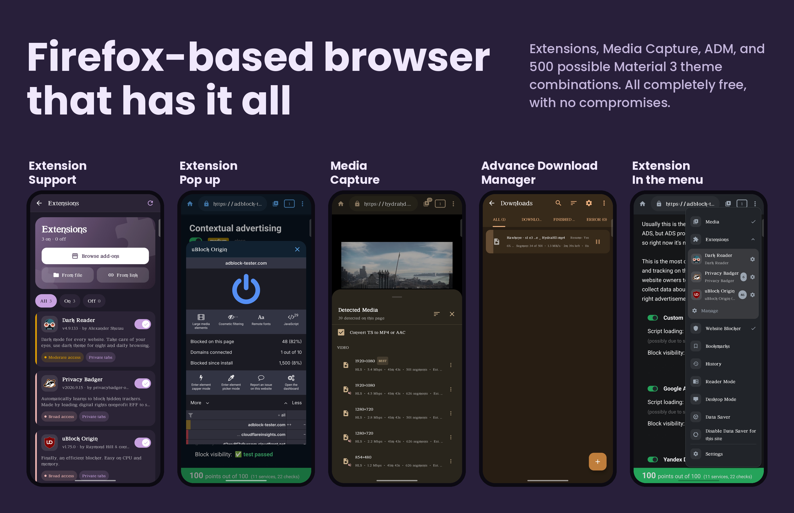
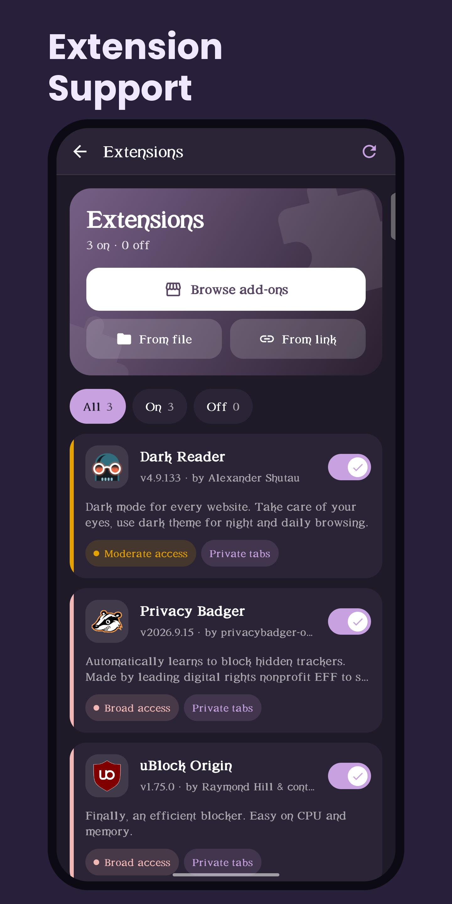
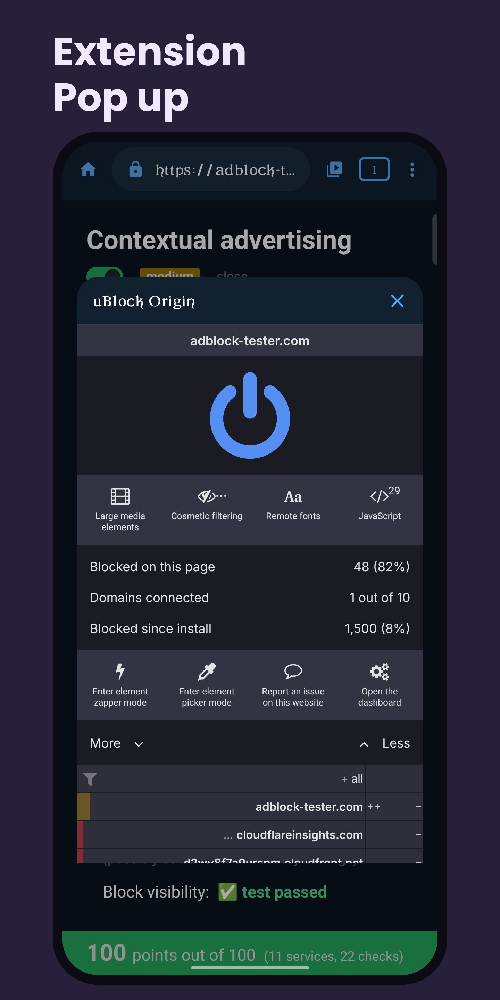
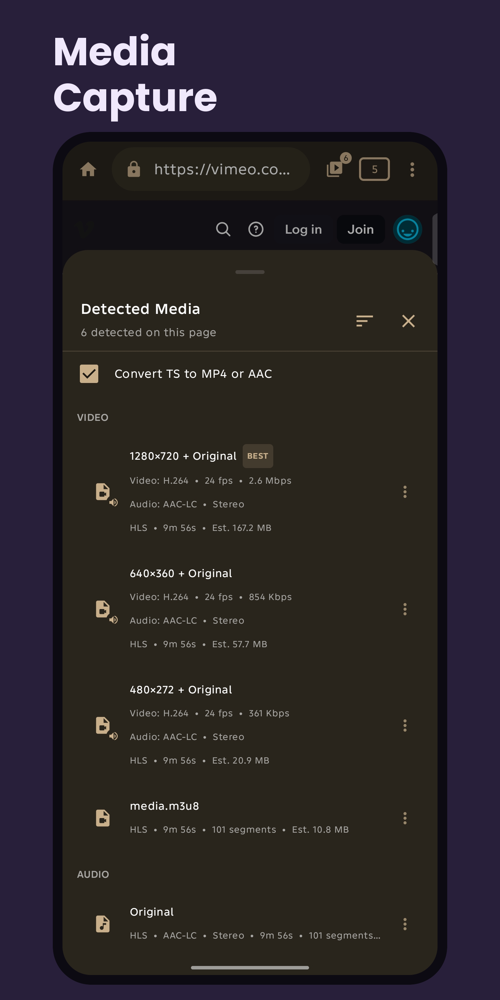
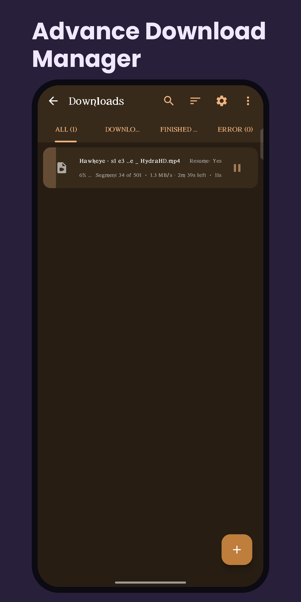
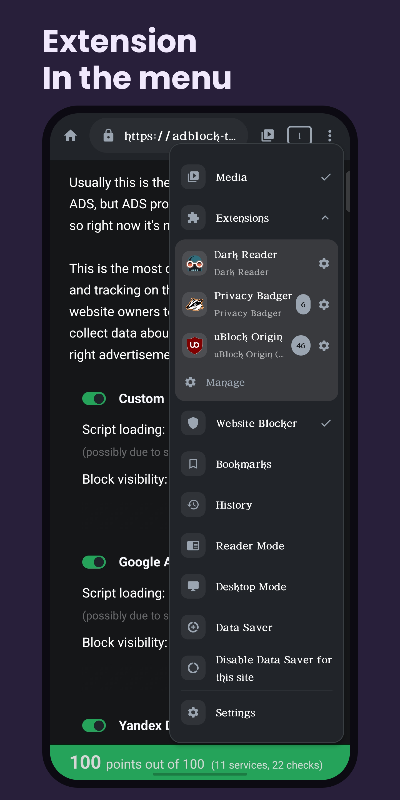

# Clint Gecko

**Customizable Layered Internet Navigation Tool**

Android Firefox-based browser with ADM, media capture, and extensions.

---

## What is Clint Gecko?
Clint Gecko is an open-source Firefox-based browser with a built-in ADM (Advanced Download Manager) and Media Capture. The goal of Clint Gecko is to be your ultimate all-in-one browser while remaining pleasant to use and highly customizable. With every update, Clint Gecko continues to get closer to that goal.

The Jhaiian ecosystem offers up to 500 possible theme combinations, allowing you to personalize your browsing experience to your liking.

Privacy is also a priority. Clint Gecko is configured to opt out of GeckoView and Mozilla telemetry, preventing telemetry data from being sent to Mozilla through those services. Clint itself doesn't collect your personal data because it has no backend, analytics, or data collection servers. Everything is designed to work directly on your device.

Official fork of [Clint Browser](https://github.com/jhaiian/ClintBrowser).

If you want a lighter version built on Android WebView, check out the original [Clint Browser](https://github.com/jhaiian/ClintBrowser).

Built and maintained by **[@jhaiian](https://github.com/jhaiian)** — a solo developer from the Philippines 🇵🇭

---

## Screenshots

  <table>
    <tr>
      <td align="center"></td>
      <td align="center"></td>
      <td align="center"></td>
      <td align="center"></td>
      <td align="center"></td>
    </tr>
  </table>

---

## Features

### 🦊 Gecko Engine

- Powered by GeckoView, the Firefox engine
- GeckoView and Mozilla telemetry are opted out

### 🧩 Extensions

- Install Firefox extensions directly in the browser
- Browse the Firefox add-on store or open an `.xpi` file
- Choose whether an extension can run in incognito tabs
- Open an extension's options page from the extension manager

### 🎧 Background Playback

- Keep audio and video playing when you switch apps or lock your screen
- Control playback from the media notification
- Can be turned on or off in the browser settings

### 🎬 Media Capture

- Detects video, audio, and subtitle streams on webpages you visit
- Supports normal video, HLS/M3U8, and DASH streams
- Download detected media directly from the browser

### ⬇️ ADM (Advanced Download Manager)

- Multi-threaded and multi-part downloads
- Pause and resume
- Download scheduler
- Speed limiter
- Custom download locations

### 🎨 UI & Customization

Clint Gecko is built with **Material 3** and **Jetpack Compose**, with a highly customizable interface.

- 50 accent colors
- Light and Dark themes
- 5 surface intensities
- **In total, 500 possible theme combinations**

### 🚫 Website Blocker

- Blocks pornography, gambling, and other unwanted categories
- Category-based filter lists (abuse, ads, crypto, drugs, fraud, gambling, and more)
- Add your own custom websites to block

### 👤 Profiles

- Stay signed in to several accounts on the same website at the same time
- Each profile keeps its own cookies, logins, and site data
- Pick a profile when opening a new tab
- Give each profile its own name and color

### 🔗 Shortcuts

- Add any website to your home screen with a custom name and icon
- Frameless mode hides the search bar and bottom bar for an app-like feel
- Manage all your shortcuts in one place with the built-in Shortcut Manager

### 🌐 Browser

- Multi-tab browsing
- Incognito mode
- Reader Mode
- Desktop Mode
- Popup protection
- Data Saver

> Just download the app and explore it yourself.

---

## Donations

### Help Keep Clint Free Forever 💜

Clint is an independent, open-source project built by one developer who believes everyone deserves a customizable browsing experience without ads, paywalls, or locked features.

Your donations help support continued development, maintenance, and future improvements. Every contribution, no matter how small, means a lot and helps keep Clint moving forward.

Clint will always remain free. Thank you for being part of this journey. 💜

---

## Requirements

- Android 8.0 (API 26) or higher

---

## Installation

Download the latest APK from the [Releases](https://github.com/jhaiian/ClintGecko/releases) page.

---

## Contributing

Contributions, bug reports, and feature requests are welcome.

1. [Open an issue](https://github.com/jhaiian/ClintGecko/issues) to report a bug or suggest a feature.
2. Fork the repo and create a branch for your change.
3. Submit a pull request with a clear description.

To report a crash, use the built‑in **Debug & Crash Reports** screen. It generates a pre‑filled GitHub issue template with your device info and crash log. For more details, see [Contributing.md](https://github.com/jhaiian/ClintGecko/blob/main/Contributing.md).

---

## Community

Join the official Clint Gecko community on Discord and Reddit to share feedback, report bugs, and connect with other users.

- **Discord** – [discord.gg/4kUe4yPQ32](https://discord.gg/4kUe4yPQ32)
- **Reddit** – [reddit.com/r/ClintBrowser](https://reddit.com/r/ClintBrowser)

---

## License

The source code of this project is licensed under the [GNU General Public License v3.0 (GPLv3)](https://github.com/jhaiian/ClintGecko/blob/main/LICENSE).  

The names "Clint" and "Clint Gecko," the logo, screenshots, and all related branding assets are **trademarks** or **proprietary assets** of the author and are **not licensed under the GPL**. Use of these assets requires explicit permission from the author.

All libraries used in this app have their own licenses. Please comply with their respective license terms. See [Attribution.md](https://github.com/jhaiian/ClintGecko/blob/main/Attribution.md) for details.

---

## Legal

- [Privacy Policy](PRIVACY_POLICY.md)
- [Terms of Service](TERMS_OF_SERVICE.md)
# ClintGecko
# ClintGecko
